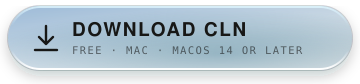

# CLN — Mac Care

<p align="center">
  <a href="https://github.com/lilyfleurs/CLN/releases/latest/download/CLN.zip">
    
  </a>
</p>

A free Mac cleaner. Scans for system junk, AI tool clutter, large and old files, app leftovers
and startup items, uninstalls apps completely, and maps your disk. Everything it removes goes to
the Trash first, and nothing leaves your Mac.

Available in English, Italiano, Deutsch, Français and Español. Two versions: 1.0.0 for macOS 14 or newer, 0.0.0 for macOS 12 or newer.

## Download

Click **Download CLN** above (or get `CLN.zip` from [Releases](https://github.com/lilyfleurs/CLN/releases/latest)),
unzip it and move **CLN.app** to Applications.

**Two versions to download**

| File | Version | Works on |
|---|---|---|
| [CLN.zip](https://github.com/lilyfleurs/CLN/releases/latest/download/CLN.zip) | 1.0.0 | macOS 14 Sonoma or newer |
| [CLN_macOS12.zip](https://github.com/lilyfleurs/CLN/releases/latest/download/CLN_macOS12.zip) | 0.0.0 | macOS 12 Monterey or newer (Intel and Apple chip Macs) |

Both look and work the same. The 0.0.0 version doesn't update itself, so check back here for new versions.

The first time you open it, macOS may say it can't check the app for malicious software. Open
**System Settings › Privacy & Security**, scroll down and click **Open Anyway** next to CLN.

## Build from source

```bash
./build_app.sh
open build/CLN.app
```

`./build_app.sh --macos12` builds the Monterey edition into `build/macOS12/`.

Needs Xcode or the Xcode Command Line Tools (Swift 5.9 or later).

## Support

CLN is freeware. If you enjoy it, a tip keeps apps like this coming:
[ko-fi.com/lilyfleurs](https://ko-fi.com/lilyfleurs)

Questions: [instagram.com/lilyfleurss](https://instagram.com/lilyfleurss)

© 2026 lilyfleurs. All rights reserved. See the terms inside the app (Privacy · Terms).
